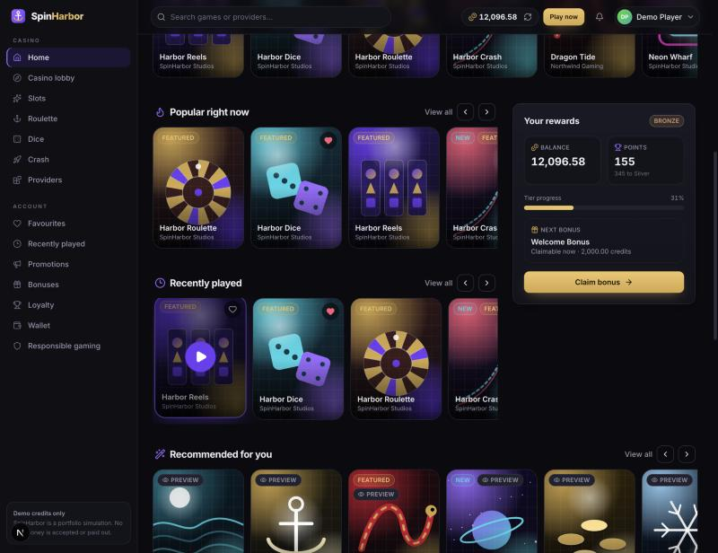
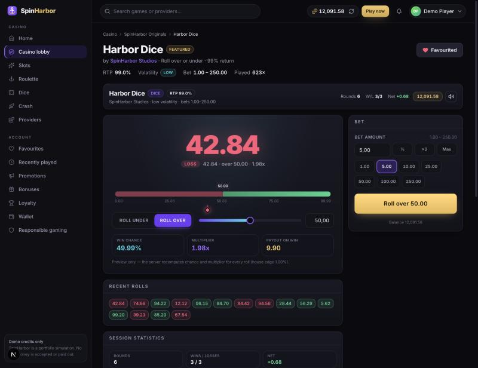
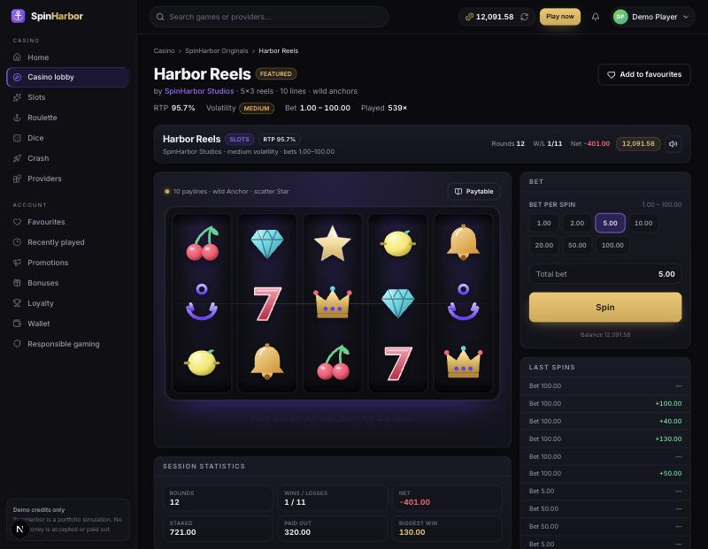
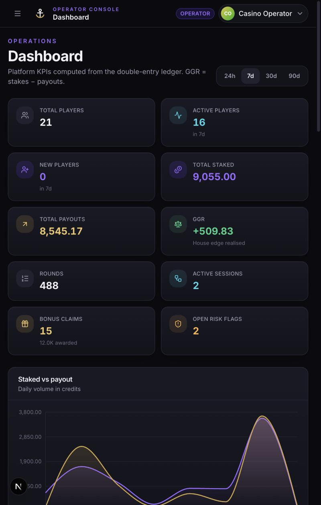

# SpinHarbor — demo-credit online casino platform & game aggregation

> Portfolio project. **All balances are virtual demo credits.** SpinHarbor is not a licensed gambling operator, accepts no deposits and pays nothing out. RNG and return-to-player figures are simulation-grade, not certified.

SpinHarbor is a full-stack iGaming platform built as a single TypeScript monorepo: a Next.js 16 player application, a NestJS 11 modular-monolith API, a PostgreSQL double-entry ledger, Socket.IO realtime, BullMQ background jobs and an operator back-office. Four original games (slots, dice, European roulette and a multiplayer crash game) run on server-authoritative engines against one virtual wallet.



| Dice | Slots | Operator dashboard |
| --- | --- | --- |
|  |  |  |

## What is implemented

**Player app** (`/`, `/casino`, `/casino/{slots,roulette,dice,crash,providers}`, `/casino/games/[slug]`, `/favorites`, `/recent`, `/promotions`, `/bonuses`, `/loyalty`, `/wallet`, `/wallet/transactions`, `/profile`, `/settings`, `/responsible-gaming`, `/login`, `/register`)
- Premium lobby with search, category / provider filters, sorting, pagination, favourites and recently played, all served by the API from PostgreSQL (20 catalogue games; 4 playable, 16 clearly marked demo previews).
- Four playable originals with backend-authoritative outcomes: **Harbor Reels** (5×3, 10 lines, wilds + scatters, paytable), **Harbor Dice** (over/under, transparent 1 % house edge), **Harbor Roulette** (single zero, straight / colour / parity / high-low / dozens / columns) and **Harbor Crash** (multiplayer, WAITING → BETTING_OPEN → RUNNING → CRASHED → SETTLED, provably-fair seed hash, auto cash-out recorded before launch).
- Virtual wallet with a double-entry journal, idempotent round and bonus endpoints, live balance over Socket.IO, full transaction history with running balances, development-only demo reset.
- Promotions, four bonus types (welcome bonus with wagering, daily reward, weekly cashback computed from real rounds, loyalty milestones), loyalty tiers Bronze → Platinum with an idempotent points formula.
- Responsible gaming: wager / loss / top-up / session-time limits enforced inside the gameplay transaction, cooling-off, self-exclusion, session-time reminders, server-side gameplay gate that also disconnects restricted accounts from realtime.

**Operator area** (`/admin/*`, roles SUPPORT < OPERATOR < ADMIN, enforced server-side)
- Dashboard KPIs, daily staked/payout/GGR series, top games, engine split, recent transactions and bonus claims, ledger health check, live activity feed.
- Player management (search, detail, suspend/reactivate/close with reason, manual adjustment, reconcile), sessions, rounds (with result JSON and linked journal entries), transactions (double-entry lines), reversals, games/categories/providers management, bonuses, promotions, risk flags, audit log, platform settings.

**Engineering**
- Shared Zod contracts validate every request once and document Swagger (`/api/docs`).
- Money is `BigInt` minor units end-to-end; journal entries always sum to zero; cached wallet balances are reconciled against the journal (tests, API endpoint and a scheduled job).
- Row-level wallet locking (`SELECT … FOR UPDATE`) plus unique idempotency keys make double spends and duplicate payouts impossible even under concurrent requests (covered by tests).
- Pure, dependency-free game engines (`packages/engines`) with an injectable RNG: `SecureRng` (node:crypto) in production, seeded / fixed RNGs in tests and the seed script.
- 49 backend tests (unit + integration against a dedicated test database) and 10 Playwright end-to-end scenarios, all passing in this repository state.

## Stack

TypeScript 5.9 · Next.js 16 (App Router, React 19) · Tailwind CSS 4 · Radix UI · TanStack Query · Zustand · React Hook Form + Zod · Motion · Recharts · NestJS 11 · Prisma 6 · PostgreSQL 16 · Redis 7 · BullMQ · Socket.IO · Jest · Playwright · pnpm workspaces · Docker Compose.

## Quick start

Prerequisites: Node ≥ 22, pnpm 11, Docker.

```bash
pnpm install
cp .env.example .env          # defaults work out of the box (Postgres :5441, Redis :6381)
docker compose up -d          # PostgreSQL + Redis (+ an empty spinharbor_test database)
pnpm db:migrate               # apply Prisma migrations
pnpm db:seed                  # demo players, catalogue, 30 days of reconciled history
pnpm dev                      # API on :4000 (Swagger at /api/docs), web on :3000
```

Reset the demo at any time with `pnpm db:reset` (drops, migrates and re-seeds). Players can also reset their own balance from the balance pill.

### Demo accounts

| Role | E-mail | Password |
| --- | --- | --- |
| Player | `player@spinharbor.demo` (also `marina_k` … `marlin_max`) | `Player123!` |
| Support (read-only staff) | `support@spinharbor.demo` | `Support123!` |
| Operator | `operator@spinharbor.demo` | `Operator123!` |
| Admin | `admin@spinharbor.demo` | `Admin123!` |

## Scripts

| Command | What it does |
| --- | --- |
| `pnpm dev` / `pnpm dev:api` / `pnpm dev:web` | Build shared packages, start both apps (or one) in watch mode |
| `pnpm build` | Production builds of every package and app |
| `pnpm typecheck`, `pnpm lint` | Strict TypeScript + ESLint across the workspace |
| `pnpm test` | Backend unit + integration tests (needs docker compose services; uses `spinharbor_test`) |
| `pnpm test:e2e` | Playwright end-to-end suite (starts/reuses the dev servers) |
| `pnpm db:migrate` / `db:seed` / `db:reset` / `db:studio` | Prisma operations against the root `.env` |
| `pnpm --filter @spinharbor/engines simulate` | Monte Carlo RTP estimate for the slots engine |

## Repository layout

```
spinharbor/
├── apps/
│   ├── web/            Next.js player app + operator area (app/, components/, features/, lib/, e2e/)
│   └── api/            NestJS modular monolith
│       └── src/ auth · users · casino · games (slots/dice/roulette/crash) · providers · wallet
│                ledger · bonuses · loyalty · risk · notifications · realtime · admin · audit · jobs
├── packages/
│   ├── database/       Prisma schema, migrations, seed
│   ├── contracts/      Zod schemas + DTO types shared by API and web
│   ├── engines/        Pure game math with injectable RNG
│   ├── ui/             Brand tokens / artwork helpers
│   └── config/         Shared tsconfig / prettier
├── infrastructure/     Postgres init scripts
├── docs/               Architecture, database, API, gameplay, transactions, providers, trade-offs
├── docker-compose.yml  PostgreSQL + Redis
└── CV_DESCRIPTION.md
```

## Documentation

- [Architecture overview](docs/ARCHITECTURE.md)
- [Database model & diagram](docs/DATABASE.md)
- [API documentation & conventions](docs/API.md) (live Swagger at `http://localhost:4000/api/docs`)
- [Gameplay flow and game rules](docs/GAMEPLAY.md)
- [Transaction lifecycle](docs/TRANSACTIONS.md)
- [Provider integration architecture](docs/PROVIDERS.md)
- [Technical trade-offs & known limitations](docs/TRADEOFFS.md)

## Testing

```bash
pnpm test        # 6 suites / 49 tests: engines, wallet & ledger, gameplay, auth & RBAC, bonuses & loyalty, crash state machine
pnpm test:e2e    # 10 Playwright scenarios: Dice and Slots player→operator flows, route smoke, RBAC, duplicate-safe bonus claim
```

Integration tests boot the real Nest application against `spinharbor_test` with a deterministic RNG injected, so payouts and outcomes are asserted exactly.

## Known limitations

See [docs/TRADEOFFS.md](docs/TRADEOFFS.md). Headlines: single-instance crash loop (no horizontal scaling of the round scheduler), no real payment or KYC flows by design, external providers are deliberately disabled integration stubs, no container images for the apps yet, no tournaments.
