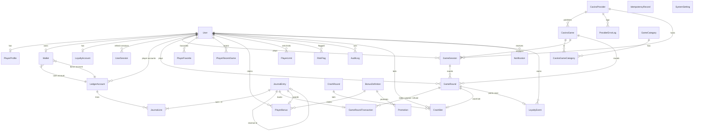

# Database model

PostgreSQL 16 via Prisma 6 (`packages/database/prisma/schema.prisma`). All monetary columns are `BigInt` minor units (1 credit = 100). Enums model every status; indexes exist on every filter used by the catalogue, history and admin queries.

## Key models and invariants

| Model | Notes |
| --- | --- |
| `User`, `UserSession`, `PlayerProfile` | Argon2 password hashes; refresh tokens stored as SHA-256; `status` + `statusUntil` drive gameplay gating; roles `PLAYER / SUPPORT / OPERATOR / ADMIN`. |
| `LedgerAccount` | `PLAYER_CASH` and `PLAYER_BONUS` per user (`@@unique([userId, type])`), singleton house accounts `HOUSE_FUNDING`, `HOUSE_GAMING`, `HOUSE_BONUS`. |
| `JournalEntry` / `JournalLine` | Immutable. `idempotencyKey` unique. Lines carry signed amounts and, for player accounts, the running `balanceAfterMinor`. Every entry's lines sum to zero (asserted in code and tests). Reversals link via `reversalOfId` (unique → an entry can be reversed once). |
| `Wallet` | Cached balances + `version`. Updated only under `SELECT … FOR UPDATE`. Reconciled against the journal by tests, `/wallet/reconcile`, `/admin/ledger/health` and a scheduled job. |
| `GameSession`, `GameRound`, `GameRoundTransaction` | A round is `OPEN` while staked, then `SETTLED` or `VOIDED` (refund). `idempotencyKey` unique per round (`userId:clientKey`). Each stake/payout/refund links to exactly one journal entry (`journalEntryId` unique → duplicate payout impossible). |
| `CrashRound`, `CrashBet` | Server seed + hash, crash point in basis points, phase timestamps. One bet per user per round (`@@unique([crashRoundId, userId])`); bet ↔ `GameRound` one-to-one for the financial trail. |
| `BonusDefinition`, `PlayerBonus`, `Promotion` | `claimKey` unique prevents duplicate claims (`userId:code[:period]`); wagering requirement/progress tracked in minor units. |
| `LoyaltyAccount`, `LoyaltyEvent` | `LoyaltyEvent.roundId` unique makes point accrual idempotent. |
| `PlayerLimit`, `RiskFlag`, `AuditLog`, `IdempotencyRecord`, `Notification`, `SystemSetting` | Player protection, operator review, append-only audit trail, stored responses for replay, operator-tunable settings. |

## Migrations & seed

- `pnpm db:migrate` applies `packages/database/prisma/migrations` (`prisma migrate deploy`).
- `pnpm db:seed` wipes demo data and regenerates: 21 players + 3 staff, 3 providers, 6 categories, 20 games, 6 bonus definitions, 5 promotions, ~2,300 historical rounds (generated by the real engines with a seeded RNG), ~3,600 journal entries, crash history, loyalty events, limits, risk flags and audit records. The script verifies that the global journal sums to zero and that every wallet reconciles before it finishes.
- `infrastructure/postgres/init/01-test-db.sql` creates `spinharbor_test`, which the Jest global setup migrates automatically.
